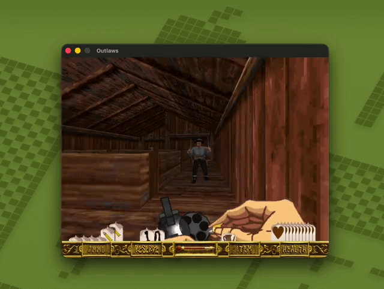
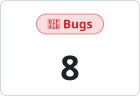
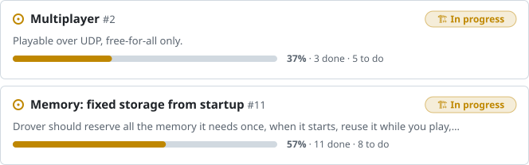
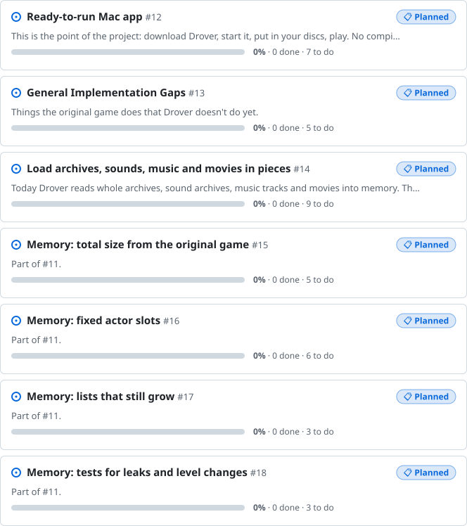
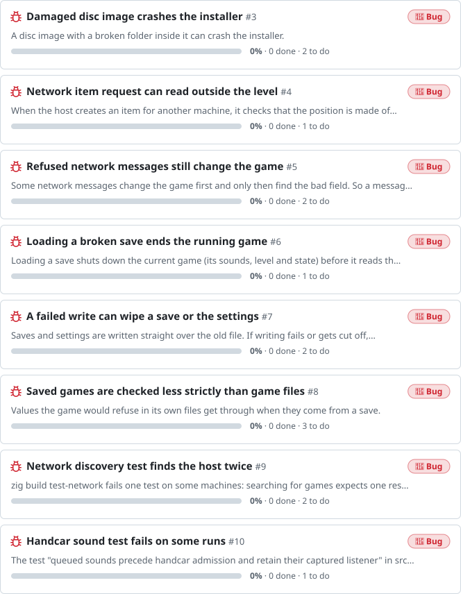

<p align="center">
  
</p>

# Drover Engine

<h6 align="center">
  <a href="#-roadmap">Roadmap</a> ·
  <a href="#-how-its-built">How it's built</a> ·
  <a href="#-contributing">Contributing</a>
</h6>

<!-- soon when workflows exist
<div align="center">
  
  
  
</div>
-->

Drover is a new implementation of the LucasArts **Jedi™ engine**, written in
[Zig](https://ziglang.org) with current methods and a modern architecture.
It plays levels made of sectors and walls with sloped floors, sprite actors,
a script engine that drives each level, a software renderer, and network play.
It reads the original data files of the games it supports and ships no game
content of its own.

**The goal:** bring Outlaws and the other Jedi engine games to Mac users as an
app you download and start, without running a compiler. Put in your original
discs, and the installer copies the game data over on first launch.

Drover is neither a look-alike that only copies how the games appear, nor a
straight translation of decompiled code into a new language. Behaviour comes
from the original program; the structure around it is new.

## 📖 The reference

LucasArts built the Jedi engine for **Star Wars™: Dark Forces™** (1995) and
shipped its last and most developed version with **Outlaws™** (1997). After
Outlaws the engine was retired.

**Outlaws is the title ported first**, and the one everything here is tested
against: it runs the newest version of the engine, fully patched, so there is
a fixed end state to match. Behaviour is taken from the original program (its
instructions, its data and its observed results), never from guesswork. Where
the original is unclear, the engine stops instead of inventing an answer.

The engine is title-agnostic. Everything specific to one game (its name, its
archive names, its disc layout) lives in
[`src/game/title.zig`](src/game/title.zig).

<p align="center">
  
</p>

## 🚀 Features

- **Levels in software**, at 640×480 indexed colour:
  - Sectors, walls, sloped floors and ceilings, skies
  - Sprite actors, geometry models, water
  - HUD, automap, inventory strip, first-person weapon, messages
- **Player**: movement and collision, weapons and shooting, pickups,
  inventory, damage, secrets, the portable lamp, rails
- **Enemies**: enemy logic, projectiles, blood and other effects, corpses,
  generators
- **Level script engine**: triggers, doors, moving floors and ceilings,
  lights, breakable walls, texture animation
- **Front end**: main menu, difficulty menu, in-level popup, save and load
  menus, the OPTIONS main page
- **Campaign startup**: the story file, the intro movies, then the first level
- **Sound and music**, and movie playback with its sound
- **Network games over UDP**: hosting, joining, the lobby, players fighting
  across machines, and the map changes that travel with them
- **Saving and loading** a campaign
- **Fixed memory budget**: one reservation at startup shared by the engine,
  SDL and the network code
- **Asset installer** ([`modules/asset_installer/`](modules/asset_installer/)):
  a standalone Zig module that copies the data off the original discs on
  first launch

## 🚧 Roadmap

- ✨ The cards below are drawn from the [issues](https://github.com/cckrause/drover-engine/issues) and update on their own
- 👉 Click a card to see those issues and their task lists
- 🤝 Add a 👍 to the issues you care about most

<div align="center">
  <a href="https://github.com/cckrause/drover-engine/issues?q=is%3Aissue+is%3Aopen+label%3Astatus%3Aidea"></a>
  <a href="https://github.com/cckrause/drover-engine/issues?q=is%3Aissue+is%3Aopen+label%3Astatus%3Atodo"></a>
  <a href="https://github.com/cckrause/drover-engine/issues?q=is%3Aissue+is%3Aopen+label%3Astatus%3Adoing"></a>
  <a href="https://github.com/cckrause/drover-engine/issues?q=is%3Aissue+is%3Aopen+label%3Abug"></a>
  <a href="https://github.com/cckrause/drover-engine/issues?q=is%3Aissue+is%3Aclosed+reason%3Acompleted"></a>
</div>

### 🏗 In progress

<div align="center">
  <a href="https://github.com/cckrause/drover-engine/issues?q=is%3Aissue+is%3Aopen+label%3Astatus%3Adoing"></a>
</div>

### 📋 Planned

<div align="center">
  <a href="https://github.com/cckrause/drover-engine/issues?q=is%3Aissue+is%3Aopen+label%3Astatus%3Atodo"></a>
</div>

### 🐛 Bugs

<div align="center">
  <a href="https://github.com/cckrause/drover-engine/issues?q=is%3Aissue+is%3Aopen+label%3Abug"></a>
</div>

### 💡 Ideas

<div align="center">
  <a href="https://github.com/cckrause/drover-engine/issues?q=is%3Aissue+is%3Aopen+label%3Astatus%3Aidea"></a>
</div>

### ✅ Recently done

<div align="center">
  <a href="https://github.com/cckrause/drover-engine/issues?q=is%3Aissue+is%3Aclosed+reason%3Acompleted"></a>
</div>

## 🛠 Usage

A ready-to-run Mac download isn't available yet; it's on the
[roadmap](#-roadmap). Until then, build it yourself.

Needs [Zig](https://ziglang.org) 0.16 and SDL2. ENet is built in from
[`vendor/`](vendor/), so there is nothing else to install.

```sh
brew install zig sdl2                                  # macOS
zig build -Dmemory-profile=development                 # on macOS into zig-out/Drover.app
zig build run -Dmemory-profile=development -- --data path/to/DATA.LAB
```

For now, play with `-Dmemory-profile=development`. The default profile,
`original_pc`, is the fixed budget the engine is moving to; until archives
and movies load in pieces, the game doesn't fit in it yet.

`-Dsdl-prefix=` points at another SDL2 install. `-Dmission=town` skips the
menus and starts that mission.

Useful flags: `--headless` (no window), `--frames N` (stop after N frames),
`--snapshot frame.ppm`, `--movie FILE.SAN`, `--patch none|1.1|2.0`,
`--installer`.

To see what the fixed budget reserves:

```sh
zig build memory-report -Dmemory-profile=original_pc
```

See [`src/memory/profiles.zig`](src/memory/profiles.zig) for what each
profile reserves.

## 🎮 Game data

Bring your own copy. The engine expects the installed data of a supported game
and never replaces a file it cannot read. A missing or broken file is an
error, not a fallback.

Point these at your own files. All three are ignored by git, and a symlink is
fine for any of them.

| Path | What goes there |
| --- | --- |
| `inputs/` | The installed discs, as `inputs/<DISC>/<GAME>/*.LAB` |
| `patches/` | The official patches, under `patches/1.1/` and `patches/2.0/` |
| `testdata/` | Generated reference files for the tests |

## 🧪 Testing

```sh
zig build test              # the engine: 400+ tests
zig build test-network      # two sessions over local UDP ports
zig build test-audio        # audio through SDL's dummy device
zig build test-installer    # the asset installer against installed discs
```

Many tests compare engine output against reference files in `testdata/`.
Those files are generated from game data and are not part of this repository.
A test whose data is missing skips instead of failing, so a fresh clone passes.

The rule is that a warning logged during a test is a broken test. The test
command doesn't enforce that yet, and some tests still print warnings; it's on
the roadmap.

## 🤖 How it's built

Drover was built with the help of AI agents, but it is not vibe-coded.

Opinions on AI in software development are split right now. My view: AI is a
tool. Letting agents loop on features, or vibe coding, doesn't have to produce
bad code, but it often produces code that developers find hard to get into.
For me, a forward-looking process means agents build features and people
review the code by hand. Code will always be part of the product's design.

On top of that, a project this size takes an enormous amount of time when you
do it alone, without a team.

The architecture comes partly from patterns found while decompiling the
original program, and partly from my own idea of how the modules should be
split.

In short: features are built with agents, code reviews are done by hand, and
the architecture is shaped by hand.

## ⚠ Two rules that matter

- **Never invent behaviour.** If the data says something the engine does not
  understand, that is an error. No placeholder art, no guessed defaults, no
  silent fallbacks.
- **Keep quirks.** Some arithmetic, ordering and overflow behaviour looks
  wrong and matters; the tests will tell you.

## 💬 FAQ

#### Does this come with a game?

No. It reads the data files of games you already own. No game files ship with
the engine or the installer.

#### Which games does it support?

Outlaws today. Dark Forces runs as a proof of concept on a separate branch.
A title is a settings value, but a game whose file formats differ needs engine
work.

#### Why a software renderer when the originals had 3D cards?

Every copy of the game could run it, and it is plain work on plain data, so it
can be tested without a window. Hardware 3D is on the
[roadmap](#-roadmap).

#### Can I play across machines?

Yes, over UDP, free-for-all. The [roadmap](#-roadmap) lists what's missing.

#### Why does it refuse to start instead of showing something?

On purpose. An engine that guesses gives you output you can't compare against
the original.

#### Was this written by AI?

With AI, not by it. See [How it's built](#-how-its-built).

## 🤝 Contributing

The [issues](https://github.com/cckrause/drover-engine/issues) hold the open
work, and the [roadmap](#-roadmap) shows where each piece stands.

The code follows these, in this order when they disagree:

- [The Power of Ten](https://spinroot.com/gerard/pdf/P10.pdf) (Gerard J.
  Holzmann, NASA/JPL): the safety rules. No recursion, bounded loops, all
  memory reserved at startup, functions of at most 60 lines, real asserts,
  no function-pointer dispatch without a reason, clean analysis.
- [Zig's style guide](https://ziglang.org/documentation/master/#Style-Guide)
  for naming, namespaces and formatting; `zig fmt` decides whitespace.
  Also the [compilation model](https://ziglang.org/documentation/master/#Compilation-Model),
  [lifetime and ownership](https://ziglang.org/documentation/master/#Lifetime-and-Ownership)
  and the [build system](https://ziglang.org/learn/build-system/).
- [TigerStyle](https://github.com/tigerbeetle/tigerbeetle/blob/main/docs/TIGER_STYLE.md)
  for declaration order, splitting functions, state and invariants.

House rules on top:

- **Tests** sit at the bottom of the file they test, or in a `_test.zig` next
  to it, and are named as a sentence about behaviour. Use
  `std.testing.allocator` so leaks fail, and `expectEqual` and friends over a
  bare `expect`. A test that needs game data skips when it is missing and never
  invents data. Any stderr output is a failure.
- **Comments** explain what the code can't, for the next person changing the
  file: plain words, present tense, no history, no notes on how the code was
  made. No original-program addresses, record offsets or global names; those
  go in issues. Every file starts with a `//!` header of two to five lines on
  what it is for and what is surprising. `///` on public declarations whose
  units, range, ownership or lifetime aren't obvious. `//` inside a function
  only for a quirk: a constant from a data format, an order that looks random
  but isn't, an overflow the code relies on.
- **Layers:** only `src/platform/` touches SDL, the OS, files, the clock or the
  socket. Nothing above `src/assets/` knows how a file is laid out on disk, and
  nothing in `src/assets/` knows what the data is for. Game-specific names,
  paths and tuning live in `src/game/`.

## 📄 License

Not chosen yet.

## ⚖️ Trademarks

Star Wars™, Dark Forces™, Outlaws™, Jedi™ and LucasArts™ are trademarks of
their respective rights holders and belong to them. All other names and marks
belong to their owners.

Drover is an independent project. It is not affiliated with, endorsed,
sponsored or approved by any of these rights holders. It ships no game
content; you need your own copy of the original games to play.
